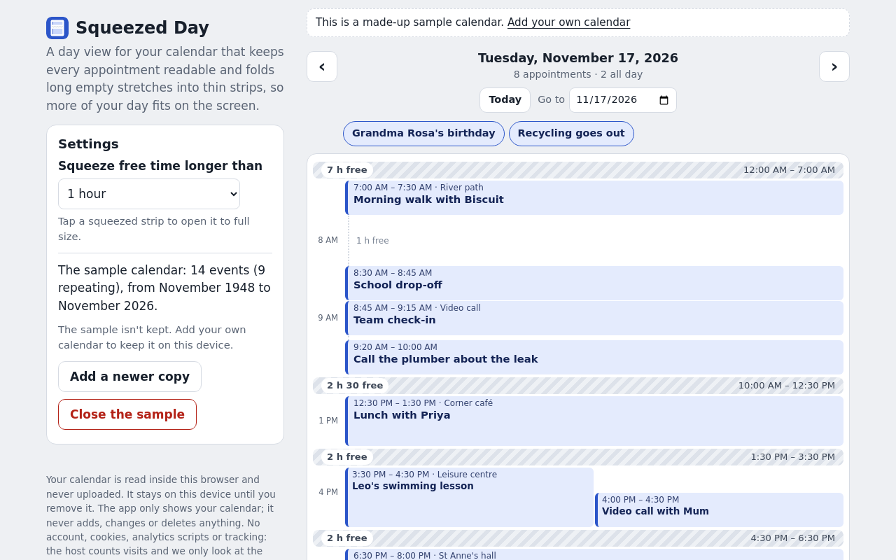

> **This app was 100% generated by AI (the Somebody Build This steward).** It was designed, written and tested by Claude Opus 5.5 (Anthropic) working through Claude Code, from this idea on the board: [A phone calendar day view that squeezes long empty stretches](https://somebodybuildthis.dev/ideas/114-a-phone-calendar-day-view-that-squeezes-long-empty-stretches).

<a href="https://somebodybuildthis.dev/ideas/114-a-phone-calendar-day-view-that-squeezes-long-empty-stretches"></a>

# Squeezed Day

A calendar day view for your phone that keeps every appointment readable and folds long empty stretches into thin strips labelled with their length ("2 h 30 free"), so more of the day fits on one screen.



## What it does

- **Reads your calendar file on your device.** Add an `.ics` file, or the `.zip` Google Calendar's export gives you (every calendar in it is shown together). Nothing is uploaded.
- **Keeps it for next time.** The calendar is kept in this browser's storage on this device, with a clear "Remove this calendar" button. It's a copy: changes made in your calendar later need a fresh export.
- **Squeezes empty time.** Any free stretch longer than an hour (you can choose 30 minutes, 1, 2 or 3 hours, or never) becomes a thin strip that says how long it is and when. Shorter gaps stay true to scale, so back-to-back and "five minutes apart" look different. Tap a strip to open it to full size.
- **Every appointment stays readable.** Each one gets enough height for its time and title; when short appointments sit close together, the timeline stretches there instead of letting them cover each other. Tap one for its full title, time and place.
- **Overlapping appointments sit side by side.** All-day events sit in a row at the top, and an event running past midnight shows on both days.
- **Getting around:** previous and next day, Today, a date picker, the arrow keys, or a swipe left or right on the day.
- **View only.** It never adds, changes or deletes anything in your calendar.
- **Try it first** with a made-up sample calendar (`public/sample-calendar.ics`), which opens on a sample day.

Works from 375px wide, follows your system's light or dark mode, has visible keyboard focus, and respects "reduce motion". No account, no cookies, no analytics scripts, no third-party scripts and no tracking by the app: the host counts visits and we only look at the totals.

## Getting a calendar file

Many calendars only export from their website on a computer, not from the phone app. The app explains this and gives short pointers, checked against each provider's own help pages:

- **Google Calendar** (on a computer): Settings, then Import & export, then Export. That downloads a `.zip`, which the app reads as it is. A single calendar: its Settings and sharing, then Export calendar ([Google's help](https://support.google.com/calendar/answer/37111)).
- **Apple Calendar on a Mac:** select the calendar, then File, Export, Export ([Apple's help](https://support.apple.com/guide/calendar/import-or-export-calendars-icl1023/mac)).
- **Outlook and others:** the app keeps this generic (look for Export or Save calendar and choose iCalendar/.ics), because the steps differ between Outlook versions.

Subscription links (a calendar's live `webcal://` address) aren't supported: reading them would need a server to fetch them, and this app has none.

## How it reads calendars

Parsing uses [ical.js](https://github.com/kewisch/ical.js) (Mozilla's iCalendar library). Around it, `src/logic/calendar.ts`:

- Shows everything in the device's own time zone. UTC (`Z`) times are exact; `TZID` times use the browser's time zone data when it knows the zone (including `/mozilla.org/...` prefixed names and common Windows names like "Pacific Standard Time"), otherwise the zone definition inside the file; times with no zone ("floating") are read as local clock time.
- All-day events (`VALUE=DATE`) use the exclusive end date, as the standard says. A timed event covering a whole day (a trip, a conference) goes in the all-day row.
- Repeating events (`RRULE`, `RDATE`) with `EXDATE` exclusions and `RECURRENCE-ID` overrides: a moved occurrence shows on its new day and disappears from the old one; a cancelled one disappears. Exclusions match even when written in a different time format from the start.
- **Big files stay fast.** The file is parsed once, in a background worker, so the page never freezes. Repeating events are only worked out around the day being viewed: plain repeating patterns (daily, weekly, monthly, yearly, without a COUNT) jump straight to the viewed day, and the occurrences found are kept so moving between days is instant. A 3 MB calendar with ten years of events and 300 repeating ones opens and shows a day in about a second in the browser, with no long tasks on the page.

`src/logic/layout.ts` is a pure function from a day's appointments to positioned blocks (appointment, free gap drawn to scale, or squeezed strip with its label) plus side-by-side columns.

## Develop

Needs Node 22+ and pnpm.

```sh
pnpm install
pnpm dev       # local dev server
pnpm test      # unit tests (vitest)
pnpm check     # typecheck + tests
pnpm build     # production build into dist/
```

- `src/logic/calendar.ts`: reading calendars and answering "what's on this day?".
- `src/logic/time.ts`: time zone conversion with the browser's `Intl` data, and local day ranges (clock-change days are 23 or 25 hours).
- `src/logic/layout.ts`: the squeezed day layout.
- `src/logic/zip.ts`: opens Google's export zip with the browser's built-in `DecompressionStream`, no library.
- `src/worker.ts`: holds the calendar off the main thread.
- `src/store.ts`: keeps the calendar in IndexedDB (and the squeeze setting in localStorage), failing softly when storage is blocked.
- `src/view.ts`, `src/main.ts`: the page. Text from calendars is always inserted as text, never as HTML.

Tests run as if the device were in New York (so daylight saving is exercised even on CI machines in UTC) and cover UTC, `TZID` (with and without a definition in the file, Windows and prefixed names), floating and all-day times, events spanning midnight, daily, weekly, monthly and yearly repeats with exclusions, moved and cancelled occurrences, daylight saving changes on both sides of the Atlantic, jumping ahead in long series (checked against walking every occurrence), a multi-megabyte calendar, the layout rules, and the sample calendar.

It is a static site (Vite + vanilla TypeScript, with ical.js as its one runtime dependency) with no environment variables, secrets or backend. It's deployed on Vercel's free tier.

## Maintenance

This app is looked after, not left behind. Dependabot proposes dependency updates. The Somebody Build This steward checks on the app each month and reviews security alerts in a weekly security check. Updates go through review and automated checks before they are merged.

Found a problem, or a calendar it reads wrongly? [Open an issue](https://github.com/TeeKraken/squeeze-day/issues) on this repository and describe what happened (please don't attach your real calendar; a small made-up file that shows the problem is perfect).

## Build your own version

Want to build your own version? Ideas never lock: anyone can build this idea too. This is just one take on [the idea](https://somebodybuildthis.dev/ideas/114-a-phone-calendar-day-view-that-squeezes-long-empty-stretches), and you're welcome to ship yours there as well.

## License

MIT. See [LICENSE](LICENSE). Not made by or affiliated with Google, Apple or Microsoft.
